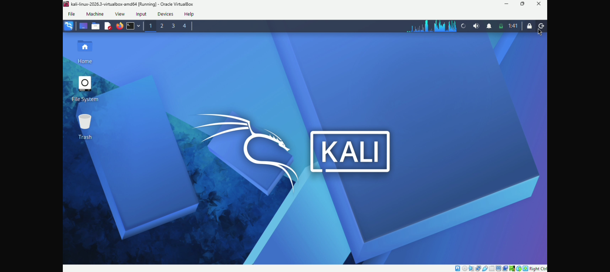
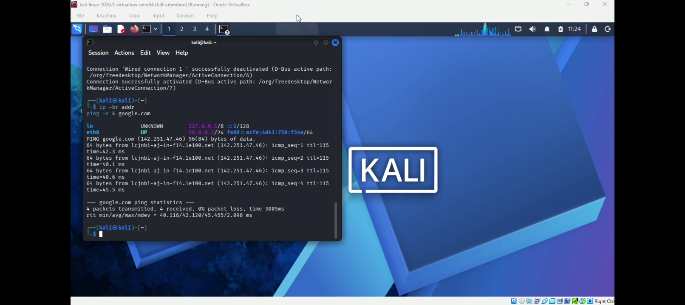

# Week 1 Project: Cybersecurity Lab Setup

## Project Overview
This project sets up a virtual cybersecurity lab using Oracle VirtualBox and Kali Linux on a 10.0.0.0/24 NAT Network.

## Screenshots & Explanations

### 1. VirtualBox Network Adapter Configuration
This shows the Kali Linux VM attached to the custom NAT Network.

### 2. VM System Settings
This confirms the VM has 2048 MB of Base Memory, 2 processors, and the correct disk attached.

### 3. Kali Linux Desktop
Proof of a successful boot into the Kali Linux graphical interface.

### 4. IP Configuration and Internet Test
The terminal shows eth0 is UP with the static IP 10.0.0.2/24. The ping google.com command shows 0% packet loss.

### 5. Virtual Machine Snapshot
A baseline snapshot named "full submission" was taken to save the clean state of the lab.

## Troubleshooting Experience
During the lab setup, I encountered challenges understanding the network configuration in Oracle VirtualBox and verifying the IP address assigned to my Kali Linux virtual machine. I reviewed the network settings and adjusted the configuration to match the intended lab requirements. I also organized screenshots of the virtual machine settings and network configuration to document the process. This experience helped me understand the importance of verifying network settings and documenting configuration changes accurately.

## Connect with Me
- *LinkedIn Post:* https://lnkd.in/p/deeRRreX
